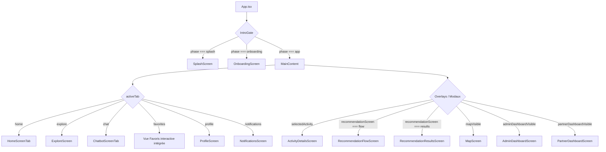

# AGENTS.md — Technical Architecture & Guidelines for Tfarhida (تفرهيدة) ⚡

This document is the **primary technical specification, architecture handbook, and context memory** for any AI assistant working on the **Tfarhida (تفرهيدة)** mobile application repository.

---

## 🚀 Product Concept, Brand & Slogan

- **Application Name**: **Tfarhida** (تفرهيدة)
- **Slug & Package**: `tfarhida` / `tn.tfarhida.app`
- **Slogan**: *"شنوّة نعمل توّا؟"* (Que fait-on maintenant ?) & *"تفرهيدتك تبدا من هنا"* (Ton évasion commence ici)
- **Goal**: Application tunisienne de découverte et recommandation d'activités, sorties et loisirs pour les jeunes, étudiants, couples et familles. Recherche intelligente par budget (DT / TND), temps/durée, distance et centres d'intérêt.
- **Villes couvertes**: Sfax (ville pilote), Grand Tunis, Sousse, Hammamet, Monastir, Bizerte, Djerba.

---

## 🎨 Design System & Visual Guidelines

1. **Brand Palette & Theme Tokens**:
   - **Central Colors**: Définies dans [`src/theme/colors.ts`](file:///c:/AT/activitytn/src/theme/colors.ts) (`WIN_COLORS`):
     - Cyan Signature: `#00D2FF`
     - Royal Blue: `#2563EB`
     - Indigo / Purple: `#6366F1` / `#9865f0ca`
     - Dark Cosmic: `#060B24` (background), `#0F172A` (cards), `#151D3B` (surfaces)
   - **Gradients & Glassmorphism**: `WIN_GRADIENTS` et `WIN_GLASS` dans `src/theme/colors.ts`.
   - **Themes**: [`src/theme/theme.ts`](file:///c:/AT/activitytn/src/theme/theme.ts) fournit `lightTheme` et `darkTheme`, consommés via `usePreferences()` depuis [`src/context/AppPreferencesContext.tsx`](file:///c:/AT/activitytn/src/context/AppPreferencesContext.tsx).
2. **Visual Style**: Light glassmorphism moderne en mode clair (dégradés azur/cyan doux, ombres portées douces, flous givrés) et Cosmic Midnight en mode sombre.
3. **Icons**: Utiliser exclusivement **`@expo/vector-icons` (`Ionicons`)**. Aucun emoji ou chaîne de caractères brute comme icône dans les composants système.
4. **Card Design**:
   - Carte canonique complète : [`src/components/ActivityCard.tsx`](file:///c:/AT/activitytn/src/components/ActivityCard.tsx) (coins arrondis `20–32`, glassmorphic badges, support multilingue et favoris).
   - Cartes spécialisées : [`ExploreActivityCard.tsx`](file:///c:/AT/activitytn/src/components/ExploreActivityCard.tsx), [`MapActivityCard.tsx`](file:///c:/AT/activitytn/src/components/MapActivityCard.tsx), [`CompactActivityCard.tsx`](file:///c:/AT/activitytn/src/components/home/CompactActivityCard.tsx).
5. **Buttons & CTAs**:
   - CTA Principal : [`src/components/ui/AnimatedGlowButton.tsx`](file:///c:/AT/activitytn/src/components/ui/AnimatedGlowButton.tsx) avec brillance animée et dégradé cyan/bleu.
6. **Navigation Bar**:
   - Barre flottante en forme de pilule : [`src/components/FloatingTabBar.tsx`](file:///c:/AT/activitytn/src/components/FloatingTabBar.tsx) (`borderRadius: 999`, flou glassmorphic, `zIndex: 9999`).
7. **Modals & BottomSheets**:
   - Règle stricte : utiliser [`src/components/ui/ScrollableModal.tsx`](file:///c:/AT/activitytn/src/components/ui/ScrollableModal.tsx) pour tout formulaire ou modal glissant vers le haut.
8. **Localization & RTL**:
   - Toutes les chaînes passent par [`src/hooks/useTranslation.ts`](file:///c:/AT/activitytn/src/hooks/useTranslation.ts) et les fichiers [`src/locales/{fr,ar,en}.json`](file:///c:/AT/activitytn/src/locales).
   - Support RTL natif pour la langue arabe (`isRTL`).

---

## 📂 Project Structure

```
activitytn/
├── App.tsx                          # Point d'entrée Expo (IntroGate, Auth & Navigation principale)
├── app.json                         # Configuration Expo (slug: tfarhida, identifiant tn.tfarhida.app)
├── AGENTS.md                        # Ce fichier de référence
└── src/
    ├── screens/                     # Écrans modulaires (1 écran = 1 fichier)
    │   ├── SplashScreen.tsx                 # Écran de démarrage animé
    │   ├── OnboardingScreen.tsx             # Parcours d'accueil / onboarding
    │   ├── AuthScreen.tsx                   # Connexion / Inscription utilisateur
    │   ├── HomeScreenTab.tsx                # Onglet Accueil (Header immersif, météo, filtres, activités phares)
    │   ├── ExploreScreen.tsx                # Onglet Explorer (recherche, catégories, filtres avancés)
    │   ├── ChatbotScreenTab.tsx             # Onglet KharjaBot / Assistant IA conversationnel
    │   ├── NotificationsScreen.tsx          # Onglet Notifications et alertes sorties
    │   ├── ProfileScreen.tsx                # Onglet Profil (préférences, langue, mode sombre, rôles)
    │   ├── ActivityDetailsScreen.tsx        # Fiche détaillée d'une activité (photos, infos, itinéraire, avis)
    │   ├── RecommendationFlowScreen.tsx     # Wizard de recommandation intelligente (budget, temps, ambiance)
    │   ├── RecommendationResultsScreen.tsx  # Résultats filtrés du moteur de recommandation
    │   ├── MapScreen.tsx                    # Vue Carte interactive géolocalisée
    │   ├── AdminDashboardScreen.tsx         # Dashboard administration plateforme
    │   └── PartnerDashboardScreen.tsx       # Espace partenaires & gestionnaires d'établissements
    ├── components/
    │   ├── ActivityCard.tsx                 # Carte d'activité canonique multilingue
    │   ├── ExploreActivityCard.tsx          # Carte compacte pour vue explorer
    │   ├── MapActivityCard.tsx              # Carte pop-up pour repères sur carte
    │   ├── FloatingTabBar.tsx               # Barre d'onglets flottante
    │   ├── GoogleMapView.tsx                # Intégration cartographique
    │   └── ui/
    │       ├── AnimatedGlowButton.tsx       # Bouton CTA avec lueur animée
    │       ├── LikeButton.tsx               # Bouton favori avec animation rebond
    │       ├── ScrollableModal.tsx          # Modal / BottomSheet scrollable universel
    │       ├── SwipeableModal.tsx           # Modal avec fermeture au swipe
    │       ├── LogoutConfirmModal.tsx       # Boîte de confirmation déconnexion
    │       ├── NewtonsCradleLoader.tsx      # Indicateur de chargement stylisé
    │       ├── OfflineBanner.tsx            # Bannière d'alerte hors-ligne
    │       └── Toast.tsx                    # Système de notifications toast in-app
    ├── context/
    │   ├── AppPreferencesContext.tsx        # Thème sombre/clair, langue courante, RTL
    │   ├── LocationContext.tsx              # Géolocalisation GPS utilisateur
    │   ├── NotificationContext.tsx          # Gestion des notifications et compteurs non-lus
    │   └── ToastContext.tsx                 # Contexte des messages toast
    ├── theme/
    │   ├── colors.ts                        # Source de vérité WIN_COLORS, WIN_GRADIENTS, WIN_GLASS
    │   ├── theme.ts                         # lightTheme & darkTheme tokens
    │   └── palettes.ts                      # Palettes d'accents dynamiques
    ├── services/                            # Couche services (API, Auth, Télémétrie, Push)
    ├── hooks/                               # Hooks personnalisés (useTranslation, useActivities...)
    ├── locales/                             # Fichiers de traduction (fr.json, ar.json, en.json)
    └── types/                               # Interfaces TypeScript (Activity, Category, AuthUser...)
```

---

## 🧭 Navigation Architecture

La navigation est pilotée par état réactif dans [`App.tsx`](file:///c:/AT/activitytn/App.tsx) :



---

## 🇹🇳 Spécificités Tunisiennes

- **Devise** : DT / TND (Dinar Tunisien).
- **Villes supportées** : Sfax, Tunis, Sousse, Hammamet, Monastir, Bizerte, Djerba.
- **Langues** : Français, Arabe Tunisien (Derja / RTL), Anglais.
- **Assistant IA** : *KharjaBot* / *Assistant Tfarhida*.

---

## ✅ Règles Obligatoires pour les Assistants

1. **1 écran = 1 fichier** situé dans `src/screens/`. Ne jamais fusionner plusieurs écrans majeurs dans un seul fichier.
2. **Icônes réelles uniquement** : Toujours utiliser `@expo/vector-icons` (`Ionicons`). Zéro emoji en guise d'icône.
3. **Palette officielle Tfarhida** : Utiliser les tokens `theme.*` issus de `usePreferences()` et les constantes de [`src/theme/colors.ts`](file:///c:/AT/activitytn/src/theme/colors.ts). Ne jamais coder de couleurs arbitraires en dur.
4. **Internationalisation obligatoire** : Aucun texte en dur dans les écrans ; passer systématiquement par `useTranslation()` et `src/locales/`.
5. **Composant modal unifié** : Toujours utiliser [`ScrollableModal`](file:///c:/AT/activitytn/src/components/ui/ScrollableModal.tsx) pour les formulaires modaux et tiroirs contextuels.
